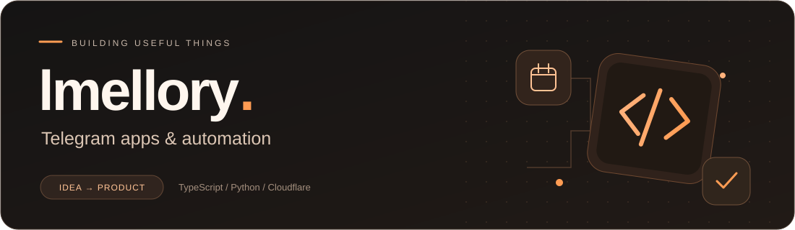
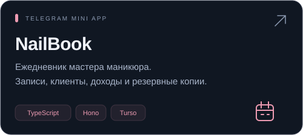
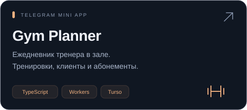
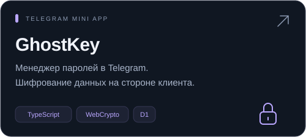
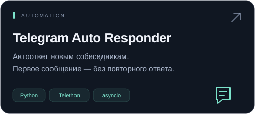
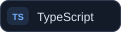
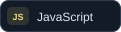
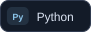

  <picture>
    <source media="(max-width: 640px)" srcset="assets/banner-mobile.svg">
    
  </picture>

## Привет, я lmellory 👋

Делаю **Telegram Mini Apps, ботов и веб-приложения**: от расписания и клиентской базы до автоматизации повседневных задач.

Мне важны удобный интерфейс, понятный код и сохранность данных.

## Избранные проекты

<table>
  <tr>
    <td width="50%"><a href="https://github.com/lmellory/nail-planner"><picture><source media="(max-width: 640px)" srcset="assets/projects/nailbook-mobile.svg"></picture></a></td>
    <td width="50%"><a href="https://github.com/lmellory/gym-planner"><picture><source media="(max-width: 640px)" srcset="assets/projects/gym-planner-mobile.svg"></picture></a></td>
  </tr>
  <tr>
    <td width="50%"><a href="https://github.com/lmellory/ghostkey-manager"><picture><source media="(max-width: 640px)" srcset="assets/projects/ghostkey-mobile.svg"></picture></a></td>
    <td width="50%"><a href="https://github.com/lmellory/tg-auto-responder"><picture><source media="(max-width: 640px)" srcset="assets/projects/auto-responder-mobile.svg"></picture></a></td>
  </tr>
</table>

Карточки открывают репозитории: описание, код и инструкции по запуску.

## Технологии в проектах

  
  
  
  
  
  

**Основной фокус:** интерфейсы для ежедневной работы, Telegram-интеграции, приложения на Cloudflare Workers и автоматизация на Python.

---

[Все репозитории →](https://github.com/lmellory?tab=repositories) · [Исходный код портфолио →](https://github.com/lmellory/portfolio)
